# AWS Cloud Infrastructure & Serverless Reporting System

**Hands-on academic cloud engineering project | AWS infrastructure, network access controls and serverless reporting**

I deployed a cafe website using Amazon S3 and configured an AWS reporting workflow with RDS MariaDB, Python Lambda functions and Amazon SNS. Captured tests show successful Lambda execution and a sales report received through SNS in the university email quarantine portal. This repository also includes a separate Google App Engine exercise, combining two university projects into one cloud portfolio.

**Education:** Bachelor of Information Technology, CQUniversity Australia — Major in Cybersecurity, Minor in Artificial Intelligence.

This work demonstrates practical skills relevant to IT Support, Cloud Support and Cloud Engineering internships, with security awareness relevant to Cybersecurity Intern and entry-level SOC Analyst roles. It represents academic laboratory work; no production operations or SOC investigation experience is claimed.

## Project at a glance

| Workstream | Implemented work | Evidence-supported outcome |
| --- | --- | --- |
| AWS static hosting | S3 objects, website hosting and public read policy | Cafe homepage and menu rendered in browser screenshots |
| AWS database and networking | RDS MariaDB; LambdaSG and DatabaseSG in a shared VPC | Database available; TCP 3306 rule configured with LambdaSG as source |
| AWS serverless reporting | Two Lambda functions; SNS topic and email subscription | Extractor test succeeded; reporting test returned 200; report appeared in email quarantine |
| GCP companion exercise | Cloud Shell, Flask, Gunicorn and App Engine | App created in australia-southeast1; deployment completed; browser displayed Hello output |

**Status:** documented historical lab results. AWS resources and public URLs have not been retested. Automatic daily scheduling, complete resource cleanup and production readiness are not established. Complete AWS source and deployment configuration were not supplied.

## Problem and objectives

The cafe scenario needed an online presence and a way to review product sales without placing reporting work on the customer-facing website. My objectives were to:

- Publish the static website and verify its content and assets in a browser.
- Configure database access using security groups rather than an unrestricted database port.
- Test separate data extraction and report delivery functions.
- Deliver a sales report using an SNS email subscription.
- Document configuration, troubleshooting, outcomes and evidence limits.

The companion GCP exercise explored managed application hosting by deploying a small Python web application. It is an independent deployment, with no AWS-to-GCP integration.

## Architecture and workflow

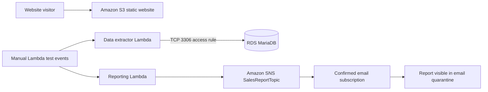

The diagram shows documented service roles and observed tests. The report describes the extractor as supplying sales data for reporting, but screenshots do not expose the exact invocation or data exchange between the two functions. No direct S3-to-Lambda trigger is demonstrated. The website and reporting workflow address the same cafe scenario but are separate components.

See [architecture details](docs/architecture.md) and the [evidence register](docs/evidence.md).

## AWS services and technologies

| Service or technology | Use supported by the supplied files |
| --- | --- |
| Amazon S3 | Static website hosting, HTML/CSS/image object layout, public object-read policy |
| Amazon RDS | MariaDB instance used in the reported database workflow |
| AWS Lambda | Data extractor and report functions; console test events |
| Amazon SNS | Standard topic, confirmed email subscription and report delivery |
| Amazon VPC and security groups | Shared VPC context; LambdaSG source for database TCP 3306 access |
| Python 3.11 and PyMySQL | Extractor runtime and visible database connection code/package |
| HTML and CSS | Deployed website assets; original files not included in the reports |
| Google App Engine and Cloud Shell | Separate managed Python application deployment |
| Flask, Gunicorn, Python 3.12 | Visible GCP application code, dependency pins and runtime configuration |

EC2 appears as the console area used for security groups and as a reporting-server alternative in the narrative; this does not establish deployment of an EC2 instance. An S3 resource policy is evidenced, but custom IAM execution-role policies are not. Secrets Manager, CloudWatch monitoring, EventBridge scheduling, Terraform and CloudFormation implementations are not demonstrated.

## My implementation process

### 1. Publish and test the S3 website

I uploaded website objects, retained `index.html`, `css/` and `images/` at the correct paths, enabled static hosting in `us-east-1`, and configured public object reads. Browser screenshots show the homepage, menu, about and visit sections. The portfolio includes the homepage and menu as the clearest presentation evidence.

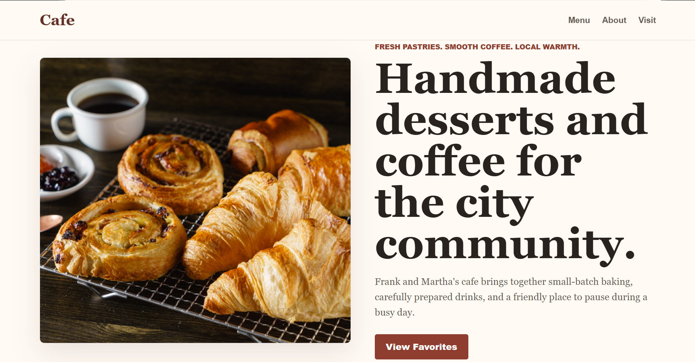

*Cafe homepage captured during testing. Browser details were cropped for privacy; the original capture used an HTTP S3 website endpoint.*

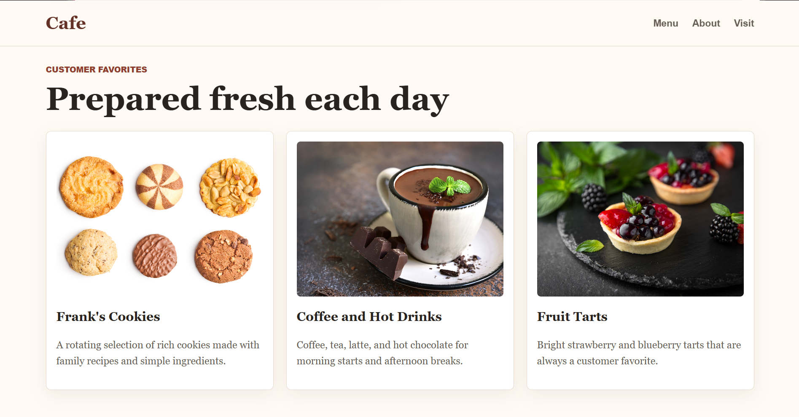

*Menu content and image assets rendered in the browser.*

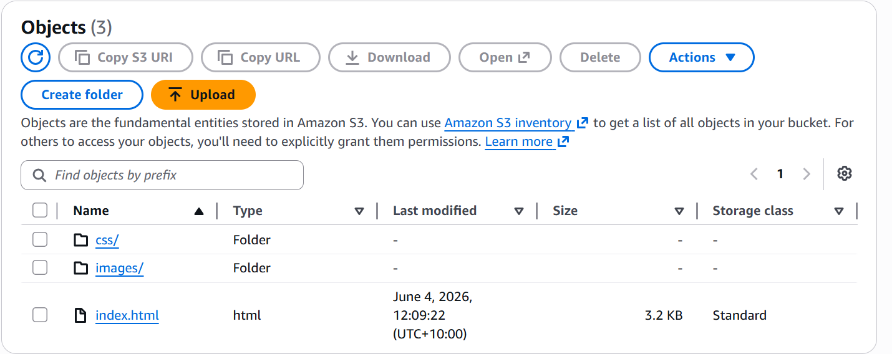

*The deployed bucket contained `index.html`, `css/` and `images/`.*

### 2. Prepare database connectivity

I created LambdaSG and DatabaseSG in the same VPC context and configured a MySQL/Aurora TCP 3306 inbound rule with LambdaSG as the source. The RDS console shows `cafe-db` with the MariaDB engine and an Available status.

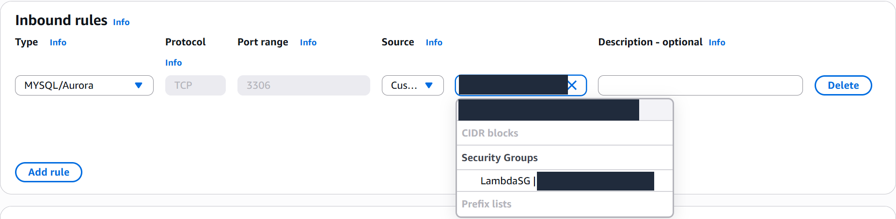

*Database rule configuration: TCP 3306 with a security group source. Resource IDs are masked; LambdaSG remains visible.*

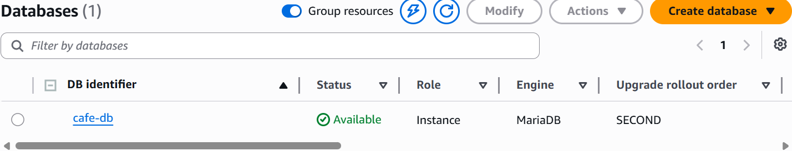

*The MariaDB instance reached Available status. This confirms provisioning, not query correctness or availability under load.*

### 3. Configure and test Lambda reporting

The extractor function used Python 3.11. Its screenshot shows PyMySQL connection and error-handling code, packaged dependency files, and a successful `dbTest` result. The reporting function's `salesReportTest` returned `statusCode: 200` with `Sales Analysis Report sent.`

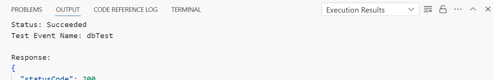

*The extractor test shows Status: Succeeded and a partially visible 200 response. Full query results and execution logs were not supplied.*

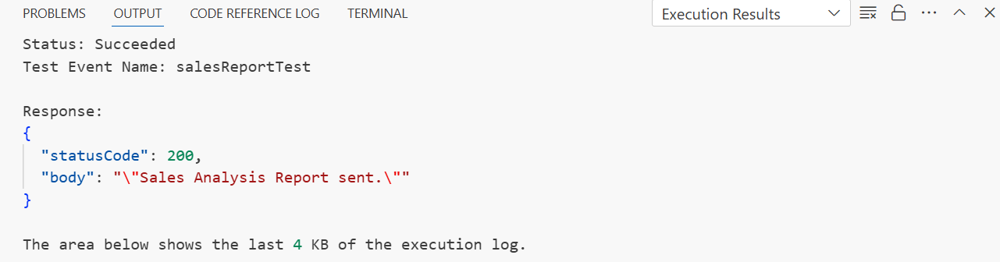

*The reporting test returned 200 and the report-sent message.*

### 4. Confirm SNS and inspect the delivered report

I created SalesReportTopic and confirmed an email subscription. The received report contained product groups and item quantities, including pastries, hot drinks and desserts.

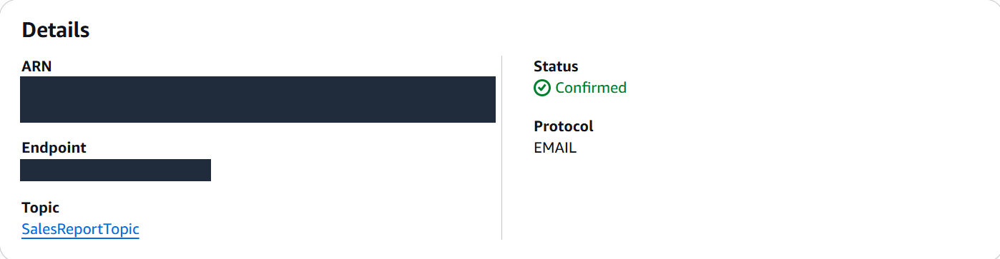

*SNS subscription status is Confirmed with EMAIL protocol. The recipient and subscription ARN are masked.*

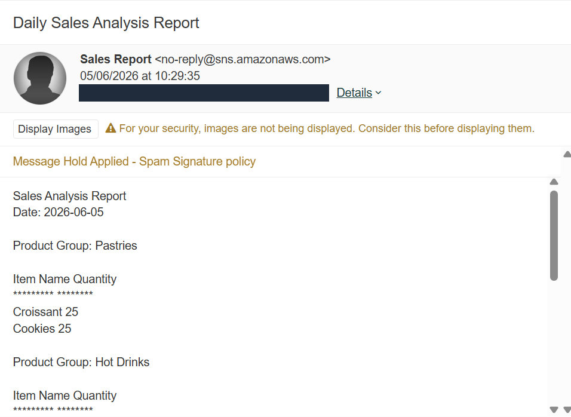

*Report visible in the university email quarantine portal, including Croissant 25 and Cookies 25. The spam hold remains visible because normal inbox delivery was not demonstrated.*

The [report continuation screenshot](images/aws/sns-report-drinks-desserts.png) shows Coffee 55, Hot Chocolate 12 and Fruit Tarts 22. These are captured lab output values, not audited business figures. Screenshots do not prove that the reported quantities match database records.

## Networking and security considerations

- **Public website boundary:** the S3 policy used public `s3:GetObject` access over all objects in the website bucket. This is broad public-read scope, so the bucket should contain only intended public assets. Block all public access was shown as Off.
- **Database access boundary:** DatabaseSG used LambdaSG as the source for port 3306. This demonstrates a service-specific network access rule. The complete effective rule set, subnet layout and route tables were not supplied.
- **Identity and credentials:** execution-role permissions and database credential storage cannot be audited from the screenshots. Secrets Manager use is not established.
- **Transport:** the captured S3 endpoint used HTTP. An RDS console connection example included certificate verification options, but this does not prove that Lambda used TLS.
- **Publication hygiene:** screenshots are cropped or masked; personal identifiers, account details and private endpoints are excluded. Original Word reports are not distributed.

See [security analysis](docs/security.md) for evidence boundaries and clearly labelled future improvements.

## Challenges and troubleshooting

| Issue | Work performed or observation | Result and limit |
| --- | --- | --- |
| S3 public access | Report describes checking permissions and policy, followed by browser tests | Website rendered; no original access-denied logs supplied |
| Website asset paths | Report describes retaining folder structure and testing after changes | Menu images rendered; no individual failed asset requests supplied |
| Lambda database access | Security groups and RDS availability checked; extractor tested | Console test succeeded; complete SQL and logs unavailable |
| SNS email delivery | Subscription confirmed; report inspected in recipient portal | Report arrived in quarantine; release to inbox not demonstrated |
| GCP shell error | Python `return` entered at shell prompt; `nano main.py` and inspection followed | Later deployment completed and browser rendered Hello output |

Full details: [troubleshooting notes](docs/troubleshooting.md).

## Testing and verified outcomes

No new AWS or GCP deployment was performed during portfolio preparation.

| Check | Captured result | What it establishes |
| --- | --- | --- |
| S3 browser view | Homepage and menu rendered | Content and assets loaded at capture time |
| RDS state | Available, MariaDB | Instance provisioned |
| Extractor console test | Succeeded; 200 partly visible | Successful recorded invocation; report states database connectivity |
| Reporting console test | 200; report-sent message | Successful recorded reporting invocation |
| SNS subscription | Confirmed; EMAIL | Subscription activated |
| Email report | Report body in quarantine | Message reached recipient's email filtering system |
| GCP deployment | Deployed default service | Deployment operation completed |
| GCP browser | Hello text with identifier | Visible application response; identifier masked in publication |

[Validation and limitations](docs/testing.md) documents the checks and missing artifacts. No uptime, load, cost savings or security compliance measurements are claimed.

## Technical skills demonstrated

- **Cloud support:** console configuration, deployment checks, resource status interpretation and service integration testing.
- **Networking:** VPC context, security group references and TCP 3306 database access controls.
- **Security awareness:** public storage scope, credential evidence gaps, privacy redaction and cautious cleanup verification.
- **Serverless workflows:** Python Lambda testing, SNS subscription confirmation and report delivery inspection.
- **Application support:** static asset paths, Python file inspection, terminal error interpretation and managed deployment.
- **Technical communication:** architecture documentation, evidence mapping and separation of results from assumptions.

## Google Cloud companion project

I created a small Flask application through Cloud Shell, configured Python 3.12 and Gunicorn, created an App Engine application in `australia-southeast1`, and deployed the default service. The browser screenshot displays the Hello response.

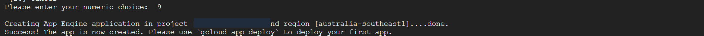

*Creation completed in `australia-southeast1`; project and terminal identity values are masked.*

The [GCP case study](docs/gcp-companion.md) includes deployment and troubleshooting evidence. [Source files](src/gcp-hello/README.md) were manually transcribed from visible screenshot content. The greeting's student identifier was replaced with `Hello`. Historical dependency pins are preserved; this is not a current production deployment recommendation.

## Lessons learned

A working cloud service depends on several layers agreeing: storage permissions and object paths for S3, network access and database readiness for reporting, and subscription confirmation plus recipient filtering for email. A successful function response is useful evidence, but the delivered message is a separate check.

I also learned to keep operational evidence precise. An empty database list in another account cannot establish deletion of the original database, and a daily report subject does not establish a daily schedule. These distinctions make technical handover and troubleshooting more reliable.

Future extensions could include source recovery, infrastructure as code, scheduled invocation, credential management and monitoring. They are proposed next steps, not completed features. See [future improvements](docs/future-improvements.md).

## Repository guide

```text
aws-cloud-infrastructure-reporting/
├── README.md
├── docs/                 # Architecture, implementation, security and evidence
├── images/
│   ├── aws/              # Sanitised AWS screenshots
│   └── gcp/              # Sanitised GCP screenshots
├── src/gcp-hello/        # Screenshot-transcribed Python application
├── config/aws/          # Sanitised screenshot-transcribed S3 policy
├── .gitignore
└── .gitattributes
```

Start with [implementation](docs/implementation.md), [security](docs/security.md) and [testing](docs/testing.md). The [screenshot index](images/README.md) records image origins and publication edits. [Publishing and LinkedIn guidance](docs/publishing.md) provides repository metadata and upload steps.

## Scope and attribution

Source material comprises two university reports and 35 embedded screenshots. The AWS report credits me with static website evidence, AWS implementation evidence and report documentation. This portfolio presents those recorded contributions without reproducing other students' details or contribution claims. Original website asset authorship and complete Lambda code authorship cannot be established from the supplied reports.

This is an evidence-led portfolio, with a small recovered GCP source example and an S3 policy example. It is not a complete, reproducible AWS deployment package. The [missing evidence list](docs/testing.md#missing-artifacts) identifies what would be needed to extend it.
