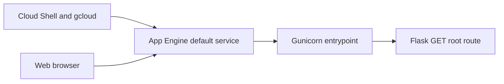

# Architecture

## AWS service boundaries

The cafe scenario has two workstreams: public static content on S3, and backend sales reporting using RDS MariaDB, Lambda and SNS. There is no demonstrated network connection between the website and reporting functions.

| Component | Role | Evidence |
| --- | --- | --- |
| S3 website bucket | Serve HTML, CSS and images | Website, objects, hosting and policy screenshots |
| LambdaSG | Identify resources permitted to reach the database | Group creation and rule configuration |
| DatabaseSG | Permit MySQL/Aurora TCP 3306 from LambdaSG | Rule editor and created group |
| RDS cafe-db | MariaDB instance for reported extraction | Available status and connection information |
| salesAnalysisReportDataExtractor | Retrieve sales data according to the report | Python 3.11, partial PyMySQL code and dbTest |
| salesAnalysisReport | Generate and send report according to the report | Function creation, salesReportTest and email |
| SalesReportTopic | SNS notification channel | Topic creation and confirmed EMAIL subscription |

The group creation screenshots share a VPC identifier. The report states that Lambda and RDS were placed in the same VPC. Actual Lambda subnet configuration, RDS subnet group, routing, NAT gateways and VPC endpoints are not visible. Do not infer a public/private subnet topology from service names.

## Reporting flow and certainty

Manual console test events are demonstrated. The extractor test succeeded, and the reporter test returned 200. The report narrative connects database extraction to report generation, but code views do not show how one Lambda invokes or exchanges data with the other. Exact SQL, schema, report date selection and the SNS publish call are unavailable.

The received report is observable in an email filtering portal. It supports arrival at the recipient's mail system, including the product quantities shown. It does not establish normal inbox delivery, scheduled execution or reconciliation against database rows.

## GCP companion architecture

The GCP exercise used its own project, Python 3.12 and the Australia App Engine region shown in the terminal. It has no demonstrated connection to AWS components. The source snapshot supplies a single Hello route, not a cafe application or reporting backend.

## Design rationale

Static hosting separates public assets from database operations. Serverless reporting avoids a dedicated reporting server in the stated scenario. No measured cost, throughput or availability benefit is supplied. The GCP exercise demonstrates another hosting model without implying a unified multi-cloud system.
