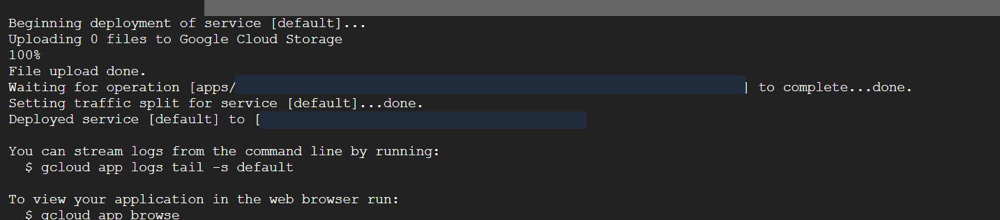
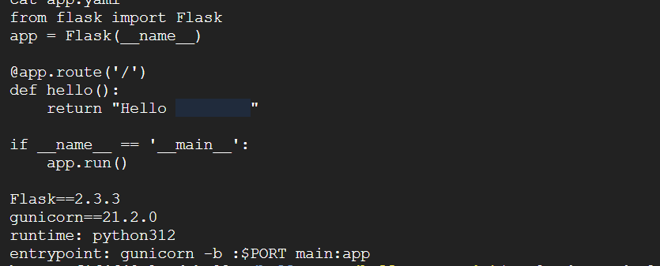

# Google App Engine companion project

The second report documents a separate Hello application on Google Cloud. It includes provider research, managed hosting and discussion of privacy, fairness, transparency and accountability. Only the hands-on deployment and relevant reflections are carried into this portfolio. Products mentioned in research, including BigQuery, Kubernetes, Cloud Run, OCI and AI services, are not treated as implemented services.

## Implemented workflow

1. A Google Cloud project was prepared and selected in Cloud Shell.
2. gcloud app create initialised App Engine.
3. Region choice 9 selected australia-southeast1; the terminal reported successful creation.
4. main.py, requirements.txt and app.yaml were created or edited.
5. The Flask route returned a Hello response containing a student identifier.
6. The default service was deployed; browser output displayed the response.

*Deployment completed and traffic was set for the default service. Project, operation and endpoint values are masked.*

*Original browser result. The student identifier following Hello is covered with an opaque privacy mask.*

## Recovered source

[Source and configuration](../src/gcp-hello/README.md) were transcribed from the visible terminal listing. The snapshot uses Flask 2.3.3, Gunicorn 21.2.0, python312 and the Gunicorn main:app entrypoint. These are historical settings, not a claim of current dependency security or runtime support. The only semantic publication edit removes the student identifier from the greeting.

*The source listing retains dependency pins and the entrypoint; the personal identifier is masked.*

The source report's broad provider comparison claims are excluded as unsuitable for current technical guidance. Ethical AI topics were written discussion only; no model, fairness evaluation or AI integration was demonstrated.

## Practical lessons

Cloud Shell commands and application code run in different contexts. Inspecting files helps distinguish terminal mistakes from application defects. Region choice and runtime configuration are useful deployment decisions to record. Removing identifiers from application output reduces unnecessary exposure in public portfolios.
