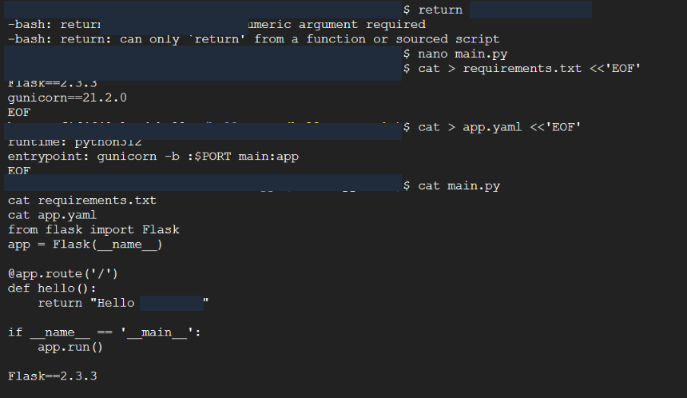

# Troubleshooting

## S3 permissions

The AWS narrative identifies public access as the primary difficulty. It describes checking bucket policy/accessibility and browser testing after changes. Final screenshots show a public read policy and rendered content. No original AccessDenied response or failed request log was provided, so no specific error code or repair timeline is claimed.

## Static asset paths

The report identifies maintaining the extracted HTML, CSS and image layout as another challenge. The S3 list and browser menu show final paths and loaded images. Individual broken-path errors are not captured. This supports checking paths and retesting rather than a specific undocumented rename.

## Database connectivity

Configuration included matching the database rule to LambdaSG, waiting for RDS availability and running dbTest. Visible code catches PyMySQL connection errors. This is error-handling code, not proof that a connection failure occurred. Complete logs and queries were not supplied.

## SNS receipt and filtering

The subscription is Confirmed, the test says the report was sent, and the report appears in the filtering portal. The message shows Message Hold Applied - Spam Signature policy. It reached the mail system but was held. No screenshot shows release, safelisting or normal inbox delivery. Receipt in quarantine is recorded without claiming a filtering fix.

## GCP Python statement entered into the shell

The screenshot shows a return statement entered at the shell prompt. The shell responded with numeric argument required and can only return from a function or sourced script. Subsequent commands show nano main.py and inspection of Python and configuration files.

The error is consistent with executing Python code in a shell context. Later deployment and browser output support successful deployment after editing, but the complete edit history is unavailable. No additional repair steps are invented.

## Cleanup verification gap

An empty RDS list and another LambdaSG screenshot appear near the cleanup section. Their AWS account differs from the RDS/Lambda implementation account. The original LambdaSG also already had zero inbound rules. These cannot establish deletion of the implementation database or removal of inbound rules after testing. Neither is included as successful cleanup evidence.
